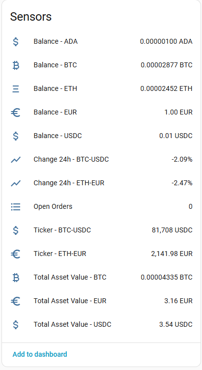

[![GitHub Release][releases-shield]][releases]
[![GitHub Activity][commits-shield]][commits]
[![License][license-shield]](LICENSE)
![Project Maintenance][maintenance-shield]

[](https://www.paypal.me/cyberjunkynl/)
[](https://github.com/sponsors/cyberjunky)

# Bitvavo Integration

A Home Assistant custom integration that exposes your [Bitvavo](https://bitvavo.com/) crypto exchange data: market prices, 24h price changes, balances, the total value of your portfolio and open orders.

## Features

- **Easy Setup**: GUI-based configuration, pick the markets you want to follow
- **Market Tickers**: last price with bid/ask and 24h open, high, low and volume
- **24h Change**: price change in percent per market, handy for automations
- **Balances**: one sensor per asset, including the amount in orders, staked amount and value in EUR. New assets show up automatically
- **Portfolio Value**: total value of all assets in EUR, BTC and USDC
- **Open Orders**: number of open buy and sell orders with an order list
- **Trading Fees**: your current maker/taker fee (disabled by default)
- **Re-authentication & reconfiguration**: replace a revoked API key or change the tracked markets without losing history
- **Diagnostics**: download diagnostics with your keys and amounts redacted

## Screenshot



## Sensors

| Sensor | Description | Unit |
|--------|-------------|------|
| Ticker - `<market>` | Last price of a market, e.g. `BTC-EUR` | quote currency |
| Change 24h - `<market>` | Price change over the last 24 hours | % |
| Balance - `<asset>` | Available + in order amount of an asset | asset |
| Total Asset Value - EUR / BTC / USDC | Value of all assets | EUR / BTC / USDC |
| Open Orders | Number of open orders | |
| Maker fee / Taker fee | Current trading fee (diagnostic, disabled by default) | % |

### Attributes

- **Ticker**: `bid_price`, `ask_price`, `bid_size`, `ask_size`, `open_24h`, `high_24h`, `low_24h`, `volume_24h`, `volume_quote_24h`, `market_status`
- **Balance**: `available`, `in order`, `staked`, `value_eur`
- **Open Orders**: `buy orders`, `sell orders`, `orders` (up to 25 orders, not stored in the recorder)

Prices and balances refresh every 20 seconds. Open orders refresh every minute, staking every 5 minutes and market details and fees every hour to stay well within the Bitvavo rate limits.

## Installation

### HACS (Recommended)

[](https://my.home-assistant.io/redirect/hacs_repository/?owner=cyberjunky&repository=home-assistant-bitvavo&category=integration)

Alternatively:

1. Ensure [HACS](https://hacs.xyz) is installed
2. Search for "Bitvavo" in HACS
3. Click **Download**
4. Restart Home Assistant
5. Add via Settings → Devices & Services → **+ Add Integration**
6. Search for "Bitvavo" and follow the setup wizard

### Manual Installation

1. Copy the `custom_components/bitvavo` folder to your `<config>/custom_components/` directory
2. Restart Home Assistant
3. Add via Settings → Devices & Services → **+ Add Integration**
4. Search for "Bitvavo"

Home Assistant 2025.1 or newer is required.

## Configuration

### Create an API key

1. Log in to Bitvavo and go to **Settings → API**
2. Create a new API key with only the **View** permission. This integration never trades or withdraws
3. Optionally restrict the key to the public IP address of your Home Assistant
4. Copy the API key and the secret (the secret is only shown once)

### Setup

1. Go to **Settings → Devices & Services**
2. Click **+ Add Integration**
3. Search for **Bitvavo**
4. Enter your API key and secret
5. Select the markets you want to follow

### Options

- **Show assets with zero value**: also create balance sensors for assets with a zero balance

### Changing markets

Open the integration, click the three-dot menu and choose **Reconfigure** to change the tracked markets.

### Replacing the API key

When Bitvavo rejects the API key (for example after deleting it), Home Assistant shows a **Reauthenticate** notification. Enter a new API key and secret there.

## Troubleshooting

### Sensors showing unavailable

- A ticker becomes unavailable when its market is not trading (halted or delisted)
- All sensors become unavailable when Bitvavo cannot be reached; check the logs

### Enable Debug Logging

Add to your `configuration.yaml`:

```yaml
logger:
  default: info
  logs:
    custom_components.bitvavo: debug
    bitvavo: debug
```

Or enable via UI: **Settings** → **Devices & Services** → **Bitvavo** → **Enable debug logging**

## Development

Open the repository in the dev container, or quick-start from the project root:

```bash
python3 -m venv .venv
source .venv/bin/activate
./scripts/setup     # install Home Assistant, lint tools and requirements
./scripts/test      # run the tests
./scripts/lint      # run the linters
./scripts/develop   # start Home Assistant with this integration on http://localhost:8123
```

## 💖 Support This Project

If you find this integration useful, please consider supporting its continued development:

[](https://www.paypal.me/cyberjunkynl/)
[](https://github.com/sponsors/cyberjunky)

## License

This project is licensed under the MIT License - see the [LICENSE](LICENSE) file for details.

[releases-shield]: https://img.shields.io/github/release/cyberjunky/home-assistant-bitvavo.svg?style=for-the-badge
[releases]: https://github.com/cyberjunky/home-assistant-bitvavo/releases
[commits-shield]: https://img.shields.io/github/commit-activity/y/cyberjunky/home-assistant-bitvavo.svg?style=for-the-badge
[commits]: https://github.com/cyberjunky/home-assistant-bitvavo/commits/main
[license-shield]: https://img.shields.io/github/license/cyberjunky/home-assistant-bitvavo.svg?style=for-the-badge
[maintenance-shield]: https://img.shields.io/badge/maintainer-cyberjunky-blue.svg?style=for-the-badge
